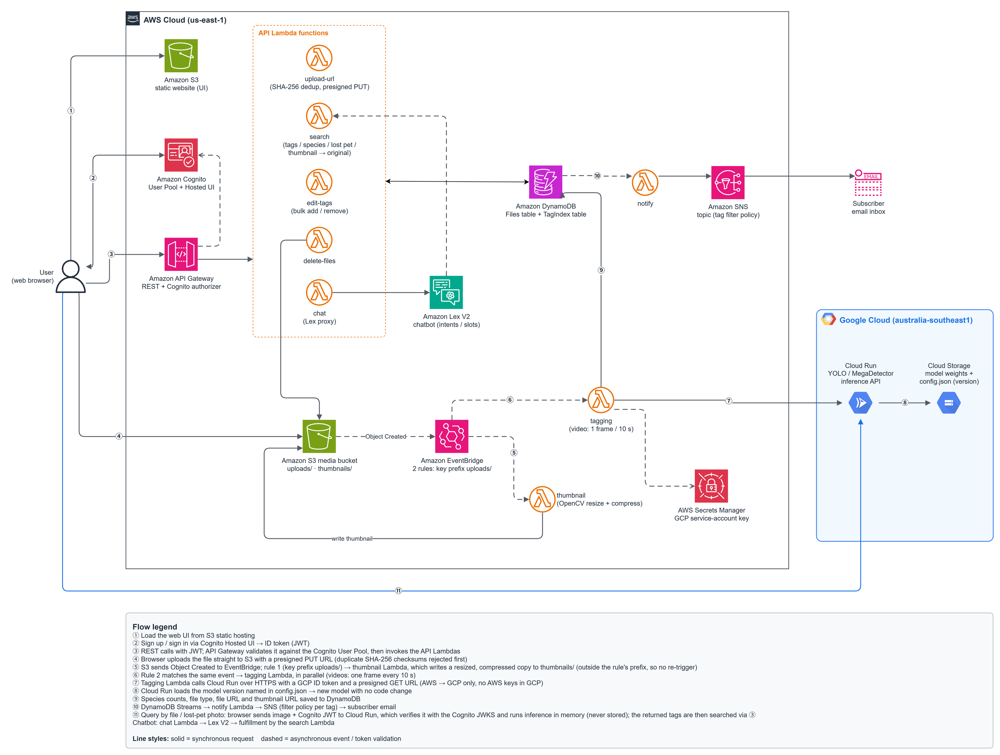

# Aussie EcoGuard: System Architecture

This document explains the multi-cloud architecture shown in [architecture.png](architecture.png) (editable source: [architecture.drawio](architecture.drawio)). The circled numbers ① to ⑪ used below match the numbered arrows in the diagram.



## 1. Overview

AWS is the primary cloud. It hosts authentication, the REST API, storage, the database, the chatbot and notifications. Google Cloud (GCP) runs the machine learning inference service and stores the model files.

| Cloud | Service | Role in the system |
|---|---|---|
| AWS | Amazon S3 (static website) | Hosts the web UI |
| AWS | Amazon Cognito | User sign-up, email verification and sign-in (Hosted UI); issues JWTs |
| AWS | Amazon API Gateway (REST) | Public API. A Cognito authorizer rejects requests that do not carry a valid JWT |
| AWS | AWS Lambda (API functions) | `upload-url`, `search`, `edit-tags`, `delete-files`, `chat` |
| AWS | Amazon S3 (media bucket) | Original files in `uploads/`, thumbnails in `thumbnails/` |
| AWS | Amazon EventBridge | Routes each S3 "Object Created" event to the thumbnail and tagging Lambdas (see §4) |
| AWS | AWS Lambda (event functions) | `thumbnail`, `tagging`, `notify` |
| AWS | Amazon DynamoDB | `Files` table and `TagIndex` table; DynamoDB Streams drive notifications |
| AWS | Amazon Lex V2 | Chatbot that turns natural-language queries into intents and slots |
| AWS | Amazon SNS | Sends tag-based email notifications, filtered per subscriber |
| AWS | AWS Secrets Manager | Holds the GCP service-account key that AWS uses to call Cloud Run |
| GCP | Cloud Run | Containerised YOLO / MegaDetector inference API |
| GCP | Cloud Storage | Model weights and a `config.json` that names the active model version |

AWS runs in `us-east-1`, the region AWS Academy Learner Lab allows. GCP runs in `australia-southeast1`.

## 2. Authentication and authorisation

1. **① Load the UI.** The browser loads the static web app from S3.
2. **② Sign up and sign in.** These go through the Cognito Hosted UI. When a user signs up, Cognito records their email, first name, last name and password, then sends a verification email. After sign-in, the browser holds a Cognito **ID token (JWT)**.
3. **③ API calls.** Every API request carries the JWT in the `Authorization` header. The API Gateway **Cognito authorizer** validates it before any Lambda runs. A user who is not signed in can only reach the sign-up and sign-in pages.
4. **Second cloud (⑪).** Cloud Run never trusts a request just because it arrives. Requests from the browser must carry the same Cognito JWT, and Cloud Run checks its signature against the User Pool's public **JWKS** endpoint (`https://cognito-idp.us-east-1.amazonaws.com/<userPoolId>/.well-known/jwks.json`). It also checks the `iss`, `aud`/`client_id` and `exp` claims. Requests from AWS (⑦) carry a Google-signed ID token for a dedicated GCP service account instead. Google's built-in Cloud Run IAM check cannot validate Cognito tokens, so it is turned off (`--allow-unauthenticated`). The service checks every request in its own code instead, and rejects anything that is neither a valid Cognito JWT nor a Google ID token issued to the AWS caller's service account.
5. **Least privilege.** Each Lambda gets only the permissions it needs, for example `s3:DeleteObject` only for `delete-files`. On AWS Academy every function shares `LabRole`. That is a known limitation, and with a personal AWS account this would become one IAM role per function.

## 3. Upload pipeline

The file never passes through API Gateway or the API Lambdas. API Gateway limits request bodies to 10 MB and synchronous Lambda calls to 6 MB, which is too small for video. Instead the browser uploads straight to S3 using a **presigned URL**.

```
Browser                API Gateway + upload-url λ        S3 media bucket        EventBridge        thumbnail λ / tagging λ
   │  ③ POST /upload-url {sha256, filename, type} + JWT      │                       │                     │
   │ ─────────────────────────────►│                          │                       │                     │
   │                               │ look up sha256 in DynamoDB                       │                     │
   │   409 duplicate  ◄────────────┤ (already stored)         │                       │                     │
   │   presigned PUT URL ◄─────────┤ (new file)               │                       │                     │
   │  ④ PUT file (direct to S3) ─────────────────────────────►│                       │                     │
   │                                                          │ Object Created ──────►│ rule 1 ──► thumbnail ⑤
   │                                                          │                       │ rule 2 ──► tagging   ⑥
```

1. **Checksum in the browser.** The browser computes the file's **SHA-256** and calls `POST /upload-url` with the checksum, file name and content type (③).
2. **Deduplication.** The `upload-url` Lambda looks the checksum up in the `Files` table. If it is already there, the API returns `409 Duplicate` with the existing file's URL and nothing is uploaded.
3. **Presigned URL.** For a new file, the Lambda returns a short-lived presigned **PUT** URL for `uploads/<sha256>.<ext>`. The URL is signed with the checksum (`ChecksumSHA256`), so S3 rejects any upload whose content does not match the checksum. As a backstop, `tagging` re-hashes the object and deletes it if the hash does not match its key.
4. **Direct upload (④).** The browser PUTs the file straight to S3.
5. **Event routing.** S3 sends an "Object Created" event to EventBridge. Two EventBridge rules, both filtered to the `uploads/` prefix, invoke the two processing Lambdas in parallel:
   - **⑤ `thumbnail`** downloads the image, resizes it while keeping the aspect ratio, compresses it with OpenCV, and writes the result to `thumbnails/`. Because the rules only match `uploads/`, writing a thumbnail does not trigger the pipeline again.
   - **⑥ `tagging`** creates a presigned **GET** URL for the object and sends it to Cloud Run (⑦). The call is authenticated with a GCP ID token minted from the service-account key held in Secrets Manager.
6. **⑦ ⑧ Inference on GCP.** Cloud Run reads `config.json` from Cloud Storage to find the active model version, loads those weights (cached between requests), runs detection and returns per-species counts such as `{"fox": 2, "cat": 1}`. **Videos:** one frame is extracted every 10 seconds and each frame is run through the detector. The stored count for each species is the highest count seen in any single frame, so the same animal is not counted twice across frames.
7. **⑨ Persist.** `tagging` writes the file type, the tag counts, the file URL and the thumbnail URL to DynamoDB.
8. **⑩ Notify.** The new item appears on the DynamoDB Stream. The `notify` Lambda publishes to SNS with the species as message attributes, and each subscriber's **filter policy** decides who receives an email.

## 4. Why EventBridge sits between S3 and the Lambdas

S3 event notifications do **not** allow two configurations with the same event type and an overlapping prefix or suffix. As a result, `uploads/` cannot trigger both `thumbnail` and `tagging` directly. EventBridge solves this without any extra code:

- With "Send notifications to Amazon EventBridge" turned on, the bucket publishes every event to the account's default **event bus**.
- Each **rule** has an event pattern, for example `source = aws.s3`, `detail-type = Object Created`, `bucket = <media bucket>` and `key` prefix `uploads/`, plus a **target** (a Lambda).
- Two rules match the same event, so both Lambdas run in parallel. Adding another consumer later is just another rule, with no change to the bucket or to existing code.
- EventBridge also provides retries and optional dead-letter queues for failed invocations.

An SNS topic fan-out (S3 → SNS → two Lambdas) would also work. EventBridge was chosen because its rules can filter on the object key and it needs no extra topic.

## 5. Query flows

All queries go through API Gateway (③) with the Cognito JWT.

| Feature | Flow |
|---|---|
| Find by tags with minimum counts, e.g. `{"fox": 2, "cane toad": 3}` | `search` queries `TagIndex` once per tag (`count >= n`) and returns the intersection of file IDs (logical AND). The response contains thumbnail URLs for images and file URLs for videos |
| Find by species, e.g. `{"cat"}` | `search` queries `TagIndex` for the species with `count >= 1` |
| Thumbnail URL to original file | `search` queries the `thumb_url` GSI on `Files` |
| Find lost pet | By tags (species, breed or colour): handled by `search` as above. By photo: same flow as "query by file" below, limited to recent sightings |
| **⑪ Query by file** | The browser sends the image with the Cognito JWT **directly to Cloud Run**, which verifies the JWT and runs detection **in memory only**. The image is never stored, as the privacy requirement demands. The browser then calls `search` (③) with the returned tags |
| Add / remove tags in bulk | `edit-tags` receives `{"url": [...], "operation": 1 or 0, "tags": [...]}` and updates `Files` and `TagIndex` together in one transaction. Removing a tag that is not present is ignored |
| Delete files | `delete-files` deletes the original and the thumbnail from S3, then deletes the `Files` and `TagIndex` items |
| Chatbot | `chat` forwards the user's text to **Lex V2**. Lex extracts the intent (e.g. `FindSightings`, `FindLostPet`) and slots (species, colour, date), and its fulfillment Lambda (`search`) returns matching media links |

## 6. Data model (DynamoDB)

The data has no relationships that need joins: every query is "files with these tags". DynamoDB is serverless, needs no VPC (an RDS database would put the Lambdas in a VPC and require a NAT gateway to reach GCP), bills per request, and its Streams feed the notification flow directly.

**`Files` table**

| Attribute | Notes |
|---|---|
| `file_id` (PK) | SHA-256 of the file content. It doubles as the deduplication key; writes use `attribute_not_exists(file_id)` |
| `file_url`, `thumb_url` | S3 locations (`thumb_url` is empty for videos) |
| `file_type` | `image` or `video` |
| `tags` | Map of species to count, e.g. `{"fox": 2, "cane toad": 3}` |
| `owner`, `created_at` | Cognito `sub`; ISO timestamp, used for "recent sightings" |
| GSI `thumb_url-index` | Thumbnail URL to original lookup |

**`TagIndex` table** (one item per tag per file)

| Attribute | Notes |
|---|---|
| `tag` (PK) | e.g. `fox` |
| `sk` (SK) | `<zero-padded count>#<file_id>`, e.g. `0002#ab12…`. Zero padding makes text order match number order, so `count >= 2` becomes the key condition `sk >= "0002#"` |

## 7. Swapping the model without changing code

The model weights live in Cloud Storage, for example `models/yolo11n-v2.pt`, and `config.json` points at the active one:

```json
{ "model_path": "models/yolo11n-v2.pt", "confidence": 0.4 }
```

Switching models means uploading new weights and editing `config.json`. Neither the Lambda functions nor the Cloud Run container need to change. Cloud Run checks the config on each cold start and at a fixed refresh interval.

## 8. Key design decisions

| Decision | Reason |
|---|---|
| ML inference on GCP Cloud Run instead of Lambda | YOLO plus PyTorch makes a container of several GB. Cloud Run handles large images, scales to zero, offers more memory per instance and has an optional GPU. This is a real technical reason to use a second cloud, not multi-cloud for its own sake |
| **AWS calls GCP, never the other way round** | AWS Academy credentials expire every few hours, so GCP must not hold AWS keys. AWS sends GCP a presigned URL and gets the result back in the HTTP response, and GCP never touches S3 or DynamoDB with AWS credentials |
| Presigned URL uploads straight to S3 | Gets around the 10 MB API Gateway / 6 MB Lambda payload limits, and the large file never passes through a Lambda |
| Checksum-signed presigned PUT | Deduplication cannot be bypassed by sending one hash and uploading different content |
| EventBridge between S3 and the processing Lambdas | One S3 event can trigger several Lambdas, and the rules filter by object key prefix |
| DynamoDB instead of RDS | No joins needed; serverless, no VPC or NAT, Streams for notifications |
| SNS for notifications | Native filter policies match the "notify me about species X" requirement with no custom matching code |

## 9. Diagram maintenance

- The diagram is drawn with draw.io's official AWS and GCP icon libraries. Open `architecture.drawio` in [app.diagrams.net](https://app.diagrams.net) or the VS Code "Draw.io Integration" extension, then export a new `architecture.png` after editing.
- `architecture_gen.py` generated the first version. The `.drawio` file has been edited by hand since then and is now the source of truth.
